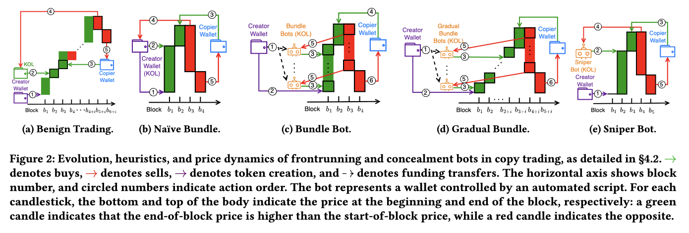
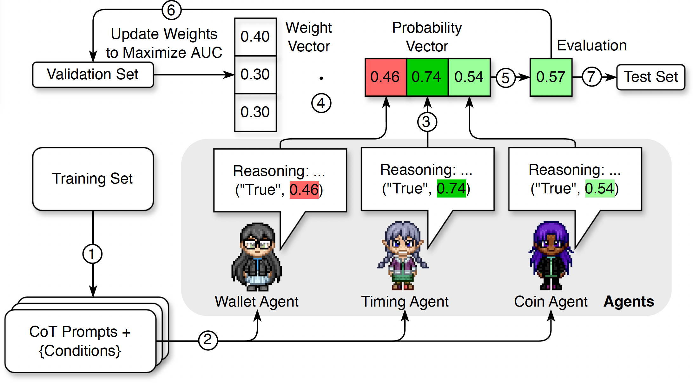

# Resisting Manipulative Bots in Meme Coin Copy Trading: A Multi-Agent Approach with Chain-of-Thought Reasoning
This repository includes the artifacts from the ACM Web Conference 2026 (WWW'26) paper entitled [Resisting Manipulative Bots in Meme Coin Copy Trading: A Multi-Agent Approach with Chain-of-Thought Reasoning](https://arxiv.org/abs/2601.08641)

## **Overview**

We model and detect manipulative bots in the meme coin market.

<p align="center">
  
</p>

We propose a manipulation-resistant copy-trading system based on a multi-agent architecture powered by a multi-modal, explainable large language model (LLM).

<p align="center">
  
</p>

## **Repository Structure**
- `environ/`: Environment configuration files and utilities.
- `scripts/`: Python scripts for data fetching, processing, and running the multi-agent system
- `diagram/`: Diagrams and figures used in the README and paper.

## **Quick Start**

### 1. Set up the environment

- Clone the repository

```
git clone https://github.com/lyc0603/copytrading.git
cd copytrading
```

- Give execute permission to your script and then run `setup_repo.sh`

```
chmod +x setup_repo.sh
./setup_repo.sh
. venv/bin/activate
```

- Set up the environmental variables

- Rename the `.env.example` file into `.env`.
- Put your Snowflake and OpenAI APIs in `.env`:

```
SNOWFLAKE_USER = "..."
OPENAI_API = "..."
```

### 2. Fetch Pumpfun Data

- Fetch Pre-Trump data

```
python scripts/fetch_pumpfun.py \
    --category pre_trump_raydium \
    --num 1000 \
    --timestamp "2024-10-17 14:01:48"
```
```
python scripts/fetch_pumpfun.py \
    --category pre_trump_pumpfun \
    --num 3000 \
    --timestamp "2024-10-17 14:01:48"
```

- Fetch Post-Trump data

```
python scripts/fetch_pumpfun.py \
    --category raydium \
    --num 1000 \
    --timestamp "2025-01-17 14:01:48"
```


```
python scripts/fetch_pumpfun.py \
    --category pumpfun \
    --num 3000 \
    --timestamp "2025-01-17 14:01:48"
```

### 3. Run the Multi-Agent System
- Run the main script

```
python scripts/multi_agent.py
```

## **License**
This project is licensed under the MIT License - see the [LICENSE](LICENSE) file for details.

## **Citation**

```
@inproceedings{luo2026resisting,
  title     = {Resisting Manipulative Bots in Meme Coin Copy Trading: A Multi-Agent Approach with Chain-of-Thought Reasoning},
  author    = {Yichen Luo and Yebo Feng and Jiahua Xu and Yang Liu},
  booktitle = {Proceedings of the ACM Web Conference (WWW)},
  year      = {2026},
  doi       = {10.1145/3774904.3792635}
}
```