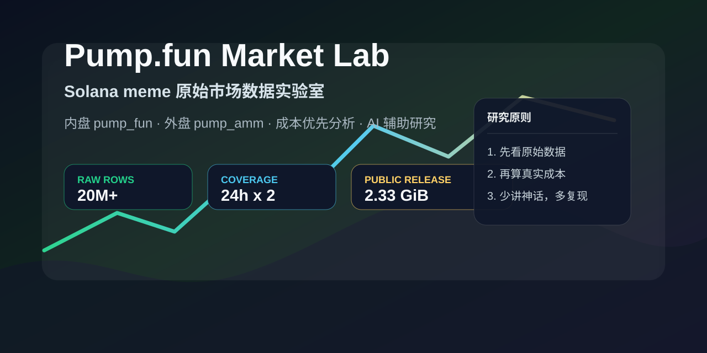
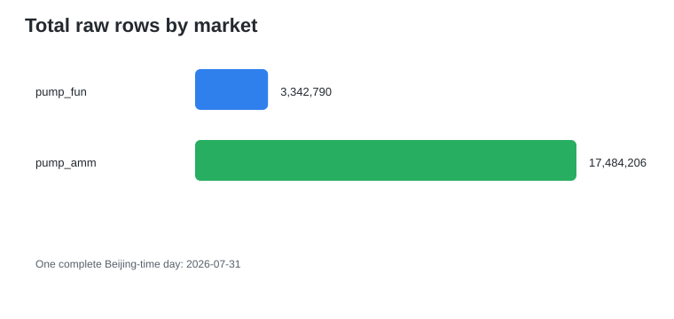
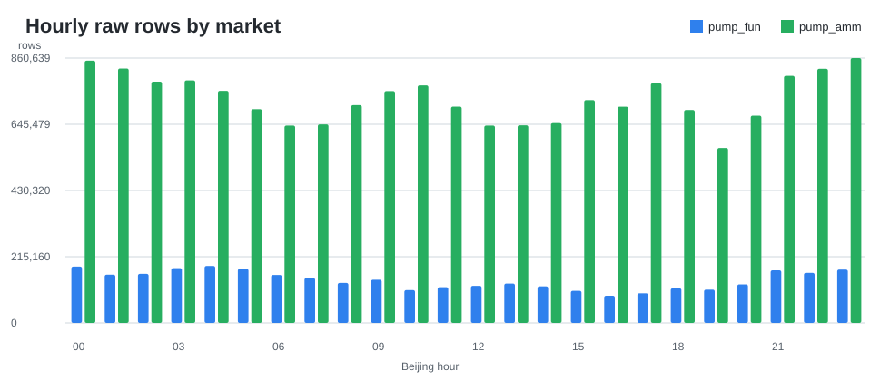
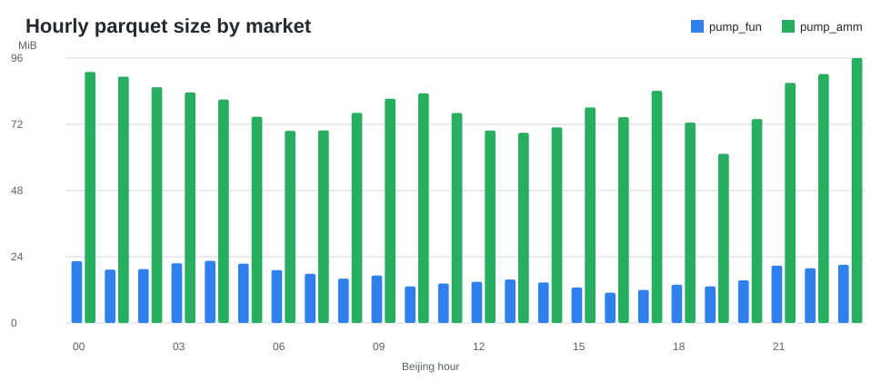

# Pump.fun Market Lab



这是一个公开的 Solana meme 原始市场数据实验室，收录了北京时间完整一天的 Pump.fun 数据，覆盖 bonding-curve / 内盘市场（`pump_fun`）和 PumpSwap / AMM / 外盘市场（`pump_amm`）。

项目目标是做可复现的数据样本、结构观察和成本优先分析，不是喊单服务，也不声称任何策略已经盈利。

## 数据集

- 北京日期：`2026-07-31`
- UTC 覆盖范围：`2026-07-30 16:00:00` 到 `2026-07-31 15:59:59`
- 市场：
  - `pump_fun`：bonding-curve / 内盘原始事件
  - `pump_amm`：PumpSwap / AMM / 外盘原始事件
- 小时文件：
  - `pump_fun`：24 / 24
  - `pump_amm`：24 / 24
- 总行数：
  - `pump_fun`：3,342,790
  - `pump_amm`：17,484,206

## 可视化概览







## 仓库结构

```text
data_manifest/   公开数据集的小时级清单
data_sample/     用于快速本地测试的一小时 parquet 样本
docs/            数据说明与使用备注
notebooks/       公开样本的 notebook 演示
reports/         生成的数据覆盖报告
scripts/         打包辅助脚本
src/             可复现的数据检查脚本
```

完整一天的原始数据不会直接放进 Git 历史，而是适合通过 GitHub Release assets 分发。完整数据约 2.39 GB，其中部分 AMM 小时文件超过 GitHub 普通文件 100 MB 限制。

## 快速开始

安装依赖：

```powershell
pip install -r requirements.txt
```

重新生成 manifest 和报告：

```powershell
python src\pumpfun_market_lab.py --day 2026-07-31 --copy-samples
```

查看生成报告：

```text
reports/pumpfun_market_2026-07-31_report.md
```

打开演示 notebook：

```text
notebooks/pumpfun_market_2026_07_31_overview.ipynb
```

进一步查看生命周期与成本演示：

```text
notebooks/token_lifecycle_and_cost_demo.ipynb
```

## 为什么做这个

meme-token 数据很容易被过拟合，也很容易被误读。一个有价值的公开样本应该把原始市场结构展示清楚，同时对交易结论保持克制。

这个实验室关注：

- 原始事件检查
- 内盘 vs 外盘市场结构
- 可复现的文件覆盖检查
- 成本优先的分析习惯
- 不包含私有钱包、API key 或私有策略的公开示例

## 安全说明

- 不包含 API key。
- 不包含私有钱包标签。
- 不声称任何交易策略已经盈利。
- 基于这份数据做回测时，应显式建模滑点、平台费、协议费、优先费、失败交易成本和基础设施成本。
